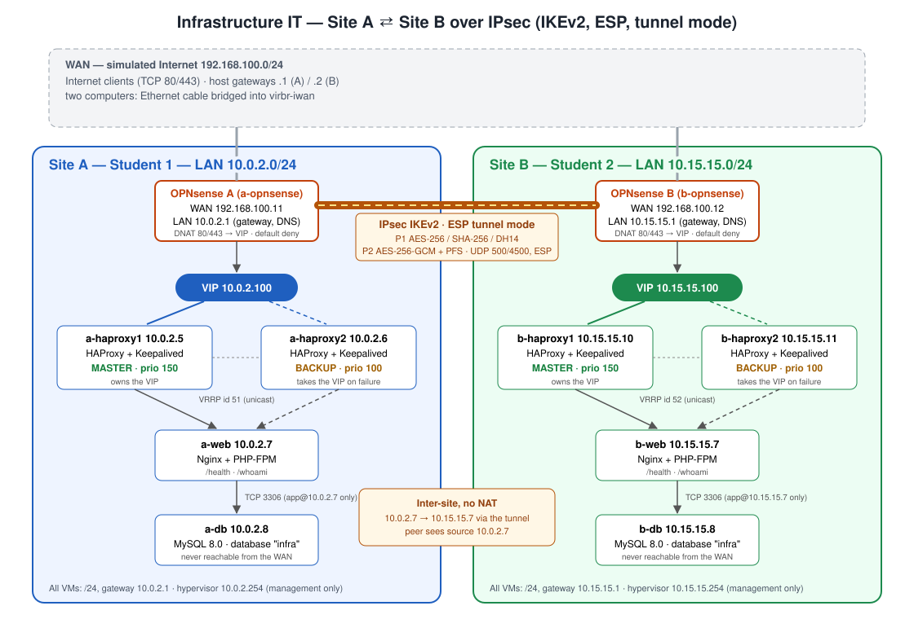
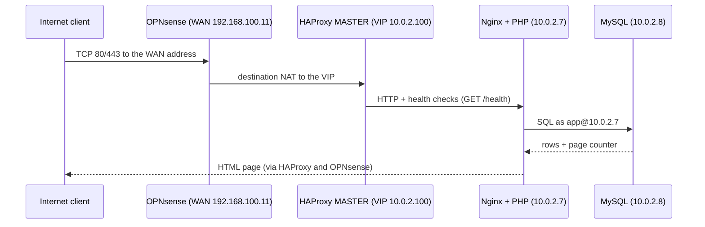
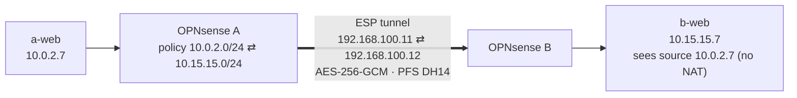

<div align="center">

# 🔐 Two-Site Infrastructure with IPsec VPN — as Code

**Two equivalent IT sites, each with a highly available web stack, joined by an
IPsec IKEv2 site-to-site tunnel between two OPNsense firewalls — built, tested
and rebuilt with a single `make` command.**


[Architecture](#-architecture) ·
[Quick start](#-quick-start) ·
[Commands](docs/COMMANDS.md) ·
[Testing](#-testing) ·
[Docs](#-documentation) ·
[Learning guide](docs/LEARNING-GUIDE.md)



</div>

---

## 📋 Table of contents

- [Overview](#-overview)
- [Highlights](#-highlights)
- [Architecture](#-architecture)
- [Tech stack](#-tech-stack)
- [Quick start](#-quick-start)
- [Everyday commands](#-everyday-commands)
- [Testing](#-testing)
- [Project status](#-project-status)
- [Repository structure](#-repository-structure)
- [Documentation](#-documentation)
- [Security](#-security)
- [Engineering notes](#-engineering-notes)
- [Limitations and roadmap](#-limitations-and-roadmap)
- [Team](#-team)

---

## 🧭 Overview

This project implements the *Infrastructure IT — VPN & site-to-site interconnection*
lab ([specification](INFRASTRUCTURE_IT_PROJECT.md)) **as Infrastructure as Code**.

Each of the two sites runs, in virtual machines on a Linux laptop:

| Layer | Component | Purpose |
|---|---|---|
| Edge | **OPNsense** firewall | routing, NAT, firewall, IPsec endpoint |
| High availability | **2 × HAProxy + Keepalived** | a virtual IP (VIP) that moves to the backup node in ~1 s |
| Application | **Nginx + PHP** | a web page that reads and writes live data in MySQL |
| Data | **MySQL 8.0** | reachable only by the web server, never from the Internet |

The two private LANs (`10.0.2.0/24` and `10.15.15.0/24`) communicate **only**
through an encrypted **IPsec IKEv2 / ESP tunnel**, with **no address translation**
between them.

The same repository runs on both students' computers: Student 1 deploys
`SITE=a`, Student 2 deploys `SITE=b`. Both sites can also run together on one
computer (`MODE=lab`) for development and as a fallback for the demo.

## ✨ Highlights

- **One command per stage** — `make all SITE=a` builds networks, 5 VMs, the
  firewall VM, MySQL, the web app, HAProxy and Keepalived from scratch.
- **Every stage is tested automatically** — 6 test playbooks plus the 6
  mandatory acceptance tests, with a generated Markdown report.
- **Real failover testing** — the tests actually stop Keepalived and HAProxy on
  the MASTER, measure the VIP move, check the site still answers, and restore.
- **Idempotent** — running any stage twice changes nothing (`changed=0`).
- **No secret in git** — passwords, keys and the IPsec PSK are generated
  locally; published configurations are automatically redacted.
- **Reproducible toolchain** — pinned Ansible in a virtualenv, checksum-verified
  OS images, MAC addresses derived from IPs.
- **Documented for learning** — every phase explained simply, with the real
  problems met and how they were diagnosed.

## 🏗 Architecture

### Addressing

| Component | Site A | Site B |
|---|---|---|
| LAN | `10.0.2.0/24` | `10.15.15.0/24` |
| OPNsense LAN / WAN | `10.0.2.1` / `192.168.100.11` | `10.15.15.1` / `192.168.100.12` |
| VIP (Keepalived, VRRP id) | `10.0.2.100` (51) | `10.15.15.100` (52) |
| HAProxy 1 — MASTER (prio 150) | `10.0.2.5` | `10.15.15.10` |
| HAProxy 2 — BACKUP (prio 100) | `10.0.2.6` | `10.15.15.11` |
| Web — Nginx + PHP | `10.0.2.7` | `10.15.15.7` |
| Database — MySQL | `10.0.2.8` | `10.15.15.8` |

Full plan with flows and IPsec parameters: [deliverables/addressing-plan.md](deliverables/addressing-plan.md).

### Traffic flows

**Public request** — a visitor on the Internet opens the site:



**Inter-site traffic** — `10.0.2.7` talks to `10.15.15.7`:



### IPsec parameters (identical, mirrored on both firewalls)

| | Phase 1 — IKE SA | Phase 2 — CHILD SA |
|---|---|---|
| Protocol | IKEv2, pre-shared key | ESP, tunnel mode |
| Crypto | AES-256 · SHA-256 · DH group 14 | AES-256-GCM · PFS DH group 14 |
| Lifetime | 28 800 s | 3 600 s |
| WAN rules | UDP 500, UDP 4500, ESP — from the peer only | IPsec rules: ICMP + HTTP from the peer LAN |

## 🧰 Tech stack

| Concern | Choice | Why |
|---|---|---|
| Hypervisor | KVM + libvirt | OPNsense (FreeBSD) needs real VMs; networks and VMs described as XML |
| Automation | Ansible 14.5 / core 2.21.5 (pinned) | provisioning, configuration and testing with one tool |
| Guests | Ubuntu 24.04 cloud image + cloud-init | a configured VM boots in ~30 s, identical every time |
| Firewall / VPN | OPNsense 26.7 (strongSwan) | required by the specification |
| Proxy / HA | HAProxy 2.8 + Keepalived (unicast VRRP) | proxy failover with health-checked backends |
| Web / DB | Nginx + PHP-FPM 8.3 · MySQL 8.0 | the page must display data from MySQL |

Rationale for every decision: [docs/LEARNING-GUIDE.md § 4](docs/LEARNING-GUIDE.md#4-why-it-is-built-this-way-decisions).

## 🚀 Quick start

### Prerequisites

| | Minimum |
|---|---|
| OS | x86-64 Linux with KVM (`/dev/kvm`) — tested on Ubuntu 26.04 |
| RAM | 8 GiB for one site (≈ 4.3 GiB used) · 16 GiB for both sites on one computer |
| Disk | 25 GB free |
| Access | `sudo` once, for the host bootstrap |

### Install and build

```bash
git clone git@github.com:yessineabdelmaksoud/infra-ipsec-two-sites.git infra && cd infra

sudo ./scripts/bootstrap-host.sh   # once per computer: KVM/libvirt, groups, Docker coexistence
make setup                         # pinned Ansible in .venv + lab SSH key (no sudo)
make all SITE=a                    # phases 1-4: networks, VMs, OPNsense VM, MySQL, web, HAProxy, Keepalived
make status SITE=a                 # one-screen health view
```

### Configure the firewall (web UI, guided)

The OPNsense settings are done in its web interface **on purpose** (a learning
goal), with click-by-click guides, then saved and verified by the tests:

| Step | Guide | Verify |
|---|---|---|
| Initial wizard, admin access | [docs/02](docs/02-phase2-opnsense.md) | `make test-phase2 SITE=a` |
| NAT 80/443 → VIP, WAN rules | [docs/05](docs/05-phase5-nat-firewall.md) | `make test-phase5 SITE=a` |
| IPsec tunnel (both sites) | [docs/06](docs/06-phase6-ipsec.md) | `make test-phase6 SITE=a` |

```bash
make opnsense-backup SITE=a        # save the firewall configuration after each GUI session
make acceptance SITE=a             # the six acceptance tests + report
```

> **Both sites on one computer?** Add `MODE=lab` to every Site B command.
> **Two computers?** Connect them with an Ethernet cable and run
> `sudo ./scripts/wan-link.sh <iface>` on both ([details](docs/06-phase6-ipsec.md#step-0--the-wan-link-and-the-shared-key)).

What's left to finish the project: **[NEXT-STEPS.md](NEXT-STEPS.md)**.

## ⌨️ Everyday commands

| Command | What it does |
|---|---|
| `make help` | list every target |
| `make all SITE=a` | build all automated phases (1–4) |
| `make status SITE=a` | VMs, VIP holder, web via VIP and WAN, tunnel — at a glance |
| `make up SITE=a` / `make down SITE=a` | start / **cleanly** stop the site's VMs |
| `make test-phaseN SITE=a` | validate one phase (N = 1…6) |
| `make acceptance SITE=a` | run the six spec tests, write the report |
| `make deliverables SITE=a` | collect configs and the redacted firewall export |
| `make opnsense-backup SITE=a` | save OPNsense `config.xml` |
| `make opnsense-rebuild SITE=a` | recreate a firewall disk that no longer boots |
| `make destroy SITE=a` | delete the site's VMs and LAN |

Full reference — setup, monitoring per layer, OPNsense shell, tcpdump, history:
**[docs/COMMANDS.md](docs/COMMANDS.md)**.

<details>
<summary>Example: <code>make status</code></summary>

```text
Site B — mode lab
VMs:      b-opnsense=running, b-haproxy1=running, b-haproxy2=running, b-web=running, b-db=running
VIP 10.15.15.100: b-haproxy1
Web via VIP:  OK, served by b-haproxy1
Web via WAN 192.168.100.12: not reachable (Phase 5 NAT not done?)
Tunnel to Site A 10.0.2.7: DOWN (Phase 6 not done, or peer off)
```
</details>

## 🧪 Testing

Every stage of the specification ends with an automated test that checks the
**requirement**, not the implementation:

| Test | Checks |
|---|---|
| `test-phase1` | networks up; each VM has exactly its planned `/24` address and gateway; full LAN ping mesh |
| `test-phase2` | Internet and DNS through OPNsense; GUI/SSH closed on the WAN; the other site unreachable outside the tunnel |
| `test-phase3` | page shows MySQL data; `mysql -h <db> -u app -p` works from the web VM and is refused elsewhere |
| `test-phase4` | VIP on the MASTER only; HTTP + HTTPS via the VIP; **stops keepalived, then haproxy**, measures the failover, restores |
| `test-phase5` | from the WAN: page served (not the GUI); 3306, 22, 8404 blocked; failover invisible from the Internet |
| `test-phase6` | IKE SA established + CHILD SA installed; ping the other site; `/whoami` proves no NAT |
| `acceptance` | the six mandatory tests of the spec, in order, with a PASS / FAIL / MANUAL report |

<details>
<summary>Example: failover measured by <code>make test-phase4</code></summary>

```text
VIP 10.0.2.100 moved a-haproxy1 -> a-haproxy2 within ~1 s; page served by a-haproxy2   (keepalived stopped)
VIP 10.0.2.100 moved a-haproxy1 -> a-haproxy2 within ~4 s; page served by a-haproxy2   (haproxy stopped)
```
</details>

## 📊 Project status

| Stage | Automation | Status |
|---|---|---|
| 1. Networks and VMs | fully automated | ✅ passing — Site A and Site B |
| 2. OPNsense | VM + console automated, settings in the GUI | ✅ automated part passing · ⏳ GUI settings |
| 3. Web + MySQL | fully automated | ✅ passing — Site A and Site B |
| 4. HAProxy + Keepalived | fully automated | ✅ passing — real failover in ~1 s |
| 5. NAT + firewall | GUI (guided) + automated test | ⏳ GUI settings |
| 6. IPsec tunnel | GUI (guided, both sites) + automated test | ⏳ GUI settings |
| Acceptance tests | automated report | ✅ 3 and 4 pass · ⏳ 1, 2, 5, 6 after stages 5–6 |

Detailed plan, decisions and progress log: [PLAN.md](PLAN.md).

## 📁 Repository structure

```text
.
├── Makefile                 # entry points: make <target> SITE=a|b [MODE=lab]
├── ansible.cfg              # Ansible settings (SSH user, key, callbacks)
├── requirements.txt         # pinned toolchain
├── inventories/
│   ├── common/              # shared by both sites: addressing plan, sizes, image pins, secrets lookups
│   ├── site_a/              # Site A machines (MASTER/BACKUP roles)
│   └── site_b/              # Site B machines
├── playbooks/               # one playbook per phase + status, power, deliverables, backup, destroy
├── roles/
│   ├── hypervisor/          # storage pool, verified Ubuntu image
│   ├── libvirt_network/     # WAN (NAT) and isolated LAN bridges
│   ├── libvirt_vm/          # VM disk overlay, cloud-init seed, domain XML
│   ├── opnsense_vm/         # OPNsense VM, console bootstrap, WAN filter
│   ├── base/                # common guest settings
│   ├── mysql/               # MySQL, database, least-privilege user
│   ├── webapp/              # Nginx + PHP page, /health, /whoami
│   ├── haproxy/             # frontend on the VIP, health-checked backend, TLS
│   └── keepalived/          # VRRP instance, track_script
├── tests/                   # test-phase1…6, acceptance.yml, shared failover tasks
├── scripts/                 # host bootstrap, OPNsense console automation, WAN cable link, XML redaction
├── docs/                    # learning docs, commands, defense guide, report template
└── deliverables/            # diagram, addressing plan, configs and acceptance reports per site
```

## 📚 Documentation

| Document | For |
|---|---|
| [docs/LEARNING-GUIDE.md](docs/LEARNING-GUIDE.md) | **Start here** — the big picture, how a `make` becomes machines, decisions, debugging stories, exercises |
| [docs/COMMANDS.md](docs/COMMANDS.md) | Every command: setup, daily use, monitoring, troubleshooting |
| [NEXT-STEPS.md](NEXT-STEPS.md) | Remaining work, as a checklist for both students |
| [docs/00](docs/00-setup.md) – [docs/06](docs/06-phase6-ipsec.md) | One page per phase: goal, picture, code explained, manual checks, problems |
| [docs/07](docs/07-acceptance-and-defense.md) | Acceptance tests, deliverables, 15-minute demo script, likely questions |
| [docs/08](docs/08-troubleshooting.md) | Troubleshooting and daily use |
| [docs/report-template.md](docs/report-template.md) | Skeleton of the written report |
| [deliverables/](deliverables/README.md) | Diagram, addressing plan, configurations, acceptance reports |

## 🔒 Security

- **Secrets stay local** — SSH key, MySQL and VRRP passwords, TLS key and IPsec
  PSK are generated into `.secrets/` (git-ignored). The PSK is exchanged between
  the two students out of band.
- **Redacted deliverables** — password hashes, private keys, the PSK and the VRRP
  password are replaced by `REDACTED` in every published file
  ([scripts/redact_opnsense_xml.py](scripts/redact_opnsense_xml.py)).
- **Minimal exposure** — from the WAN, only TCP 80/443 (to the VIP) and IPsec from
  the peer firewall are allowed; the firewall GUI and SSH listen on the LAN only.
- **Least privilege in the database** — the `app` user exists only for the web
  server's address, with `SELECT` / `UPDATE` on two tables.
- **No path around the tunnel** — a libvirt network filter makes the lab WAN behave
  like the Internet (private LANs not routable), and a test enforces it.

## 🛠 Engineering notes

Problems met while building this, and how they were solved — each one is
explained step by step in the docs:

| Problem | Root cause | Fix |
|---|---|---|
| libvirt hooks and VM disks denied | Ubuntu's AppArmor profile for libvirt | helper under `/etc/libvirt/hooks/`, file-based disks |
| VMs lost Internet when Docker started | Docker's `FORWARD DROP` policy | libvirt hook + systemd unit allowing the lab bridges |
| Firewalls hung at boot, no console output | a hard power-off corrupts the OPNsense nano disk | clean shutdowns, `make opnsense-rebuild`, config backups |
| `apt` locked during builds | Ubuntu unattended upgrades | `base` role disables them on lab VMs |
| nginx served the old page after a "successful" reload | `bind()` failure only logged | listen on `80`, check logs not exit codes |
| LANs reachable without the tunnel (one computer) | the host routed and masqueraded between the LANs | network filter on the OPNsense WAN cards |

## 🗺 Limitations and roadmap

**Limitations** (by design of the specification):

- High availability covers the **proxy layer only** — one web server, one MySQL
  and one firewall per site.
- HTTPS uses a self-signed certificate; the "Internet" is a simulated segment.
- The two-computer cable link is written but not yet exercised on two machines.

**Possible next steps:** a second web server behind HAProxy · MySQL replication
between the sites over the tunnel · OPNsense CARP pair · certificate
authentication instead of a PSK · OPNsense configuration through its API.

## 👥 Team

| Role | Site | Responsibilities |
|---|---|---|
| Student 1 — Yessine Abdelmaksoud | Site A | Site A build, automation, documentation |
| Student 2 — *(teammate)* | Site B | Site B build, IPsec configuration with Student 1 |

Course project — *Infrastructure IT: VPN & site-to-site interconnection
(SSL/TLS · IPsec · OPNsense)*, OliveSoft, October 2026.
